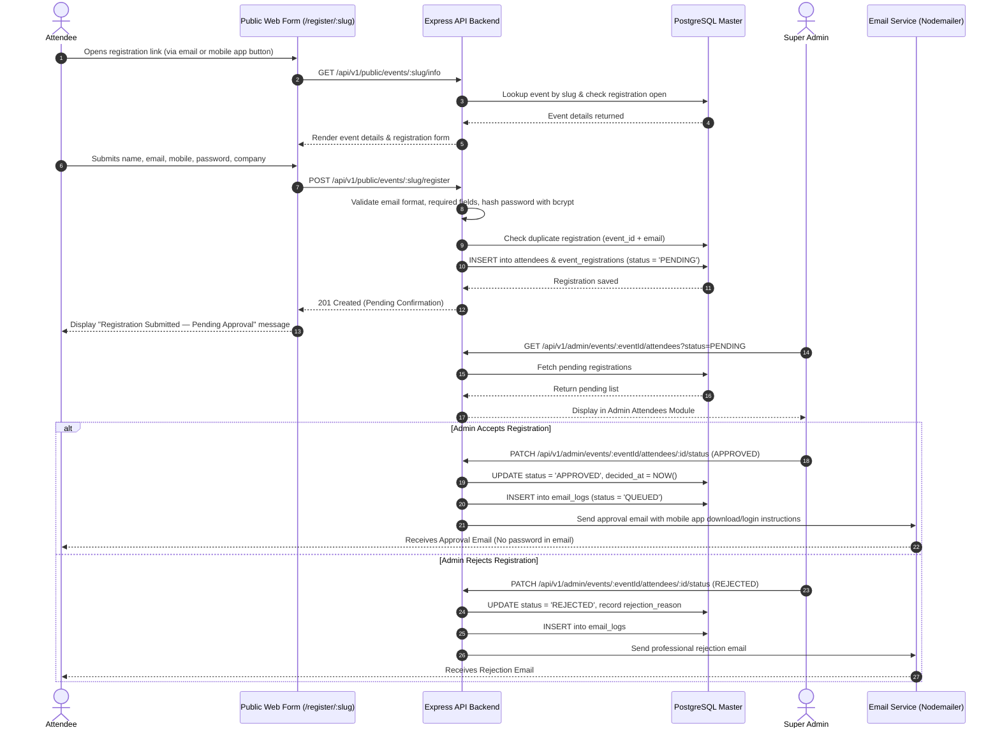
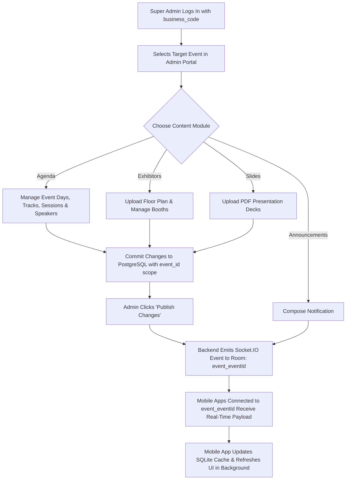
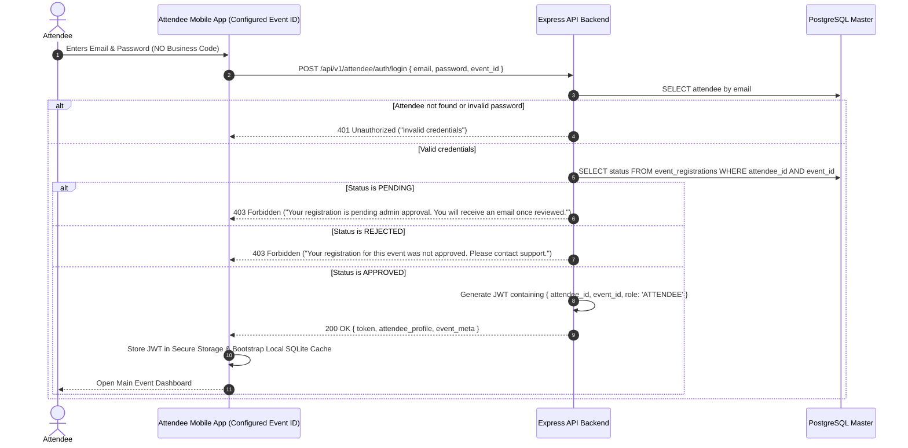
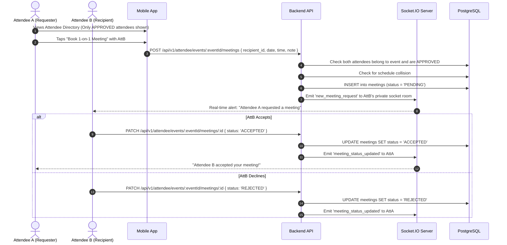
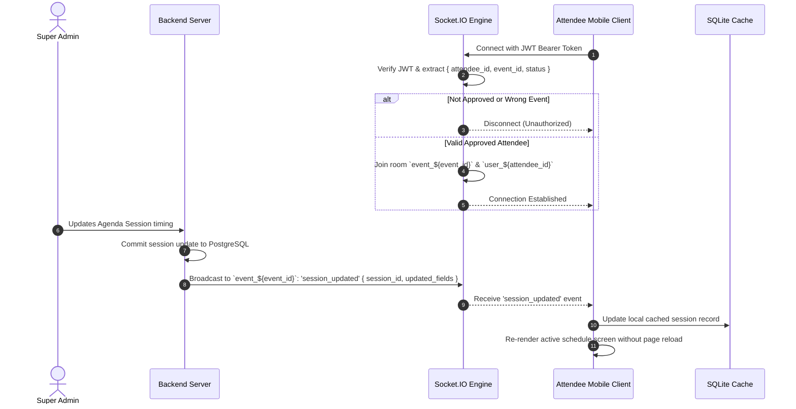

# ONFRA — Event Management & Networking Platform
## Master Implementation Blueprint & Architecture Specification

---

### Executive Overview & Source of Truth
This document is the **authoritative technical implementation plan** and system specification for the **Onfra Event Management and Networking Platform**. It governs all architectural decisions, database models, security boundaries, API contracts, and user workflows across the platform components:

1. **Admin Web Application** (`apps/react`): React JS Single Page Application for the Super Admin.
2. **Shared Backend API & Real-time Server** (`apps/backend`): Node.js & Express.js REST API with Socket.IO.
3. **Attendee Mobile Application** (`apps/attendee-mobile`): React Native CLI mobile app with SQLite local caching.
4. **Public Attendee Registration Route**: Public responsive web page (`/register/:eventSlug`).
5. **PostgreSQL Database**: Authoritative cloud/server data store.
6. **SQLite Storage**: Client-side local cache for offline/fast read access in the mobile app.
7. **Transactional Email Service**: Automated approval, rejection, and notification emails.

---

## Table of Contents
- [1. Role, Objectives & Scope Boundaries](#1-role-objectives--scope-boundaries)
- [2. Technology Stack & Project Structure](#2-technology-stack--project-structure)
- [3. Core Business Model & Event Isolation](#3-core-business-model--event-isolation)
- [4. Deliverable 1: System Requirements & Architecture](#4-deliverable-1-system-requirements--architecture)
- [5. Deliverable 2: Complete Page-by-Page Breakdown](#5-deliverable-2-complete-page-by-page-breakdown)
  - [5.1 Admin Web Application Pages](#51-admin-web-application-pages)
  - [5.2 Public Registration Web Page](#52-public-registration-web-page)
  - [5.3 Attendee Mobile Application Screens](#53-attendee-mobile-application-screens)
- [6. Deliverable 3: Ordered Database Table Specification](#6-deliverable-3-ordered-database-table-specification)
- [7. Deliverable 4: Complete DBML Schema (dbdiagram.io)](#7-deliverable-4-complete-dbml-schema-dbdiagramio)
- [8. Deliverable 5: Database Design Explained in Tamil / Tanglish](#8-deliverable-5-database-design-explained-in-tamil--tanglish)
- [9. Deliverable 6: System Architecture Diagram](#9-deliverable-6-system-architecture-diagram)
- [10. Deliverable 7: Workflow Flowcharts (Mermaid Diagrams)](#10-deliverable-7-workflow-flowcharts-mermaid-diagrams)
  - [Flow A: Public Registration & Admin Approval](#flow-a-public-registration--admin-approval)
  - [Flow B: Admin Event Content Management & Publishing](#flow-b-admin-event-content-management--publishing)
  - [Flow C: Attendee Login & Access Verification](#flow-c-attendee-login--access-verification)
  - [Flow D: Attendee Networking, Meetings & Chat](#flow-d-attendee-networking-meetings--chat)
  - [Flow E: Socket.IO Real-Time Updates & Sync](#flow-e-socketio-real-time-updates--sync)
- [11. Deliverable 8: Comprehensive REST API Specification](#11-deliverable-8-comprehensive-rest-api-specification)
- [12. Deliverable 9: Implementation Roadmap & Milestones](#12-deliverable-9-implementation-roadmap--milestones)
- [13. Deliverable 10: Assumptions & Open Architectural Decisions](#13-deliverable-10-assumptions--open-architectural-decisions)
- [14. Data Synchronisation Strategy: PostgreSQL vs. SQLite](#14-data-synchronisation-strategy-postgresql-vs-sqlite)
- [15. Security, Validation & Event Isolation Blueprint](#15-security-validation--event-isolation-blueprint)
- [16. Quality Assurance & Acceptance Test Matrix](#16-quality-assurance--acceptance-test-matrix)

---

## 1. Role, Objectives & Scope Boundaries

### 1.1 Single Super Admin Model
- Exactly **one Super Admin account** exists in the platform, established via a secure seed script or controlled backend setup.
- **No public admin registration** and no multi-admin role management screens are permitted in this version.
- The Super Admin logs in using **Admin Credentials (email/username + password) AND a unique `business_code`**.
- The Super Admin has authority to create and manage multiple events.

### 1.2 Event Isolation & Context
- Every event is assigned a unique, immutable `event_id` (UUIDv4) and a human-readable URL `slug` (e.g., `tech-summit-2026`).
- All event-specific entities (days, tracks, sessions, speakers, slides, exhibitors, sponsors, attendees, meetings, photos, notifications) **must explicitly reference `event_id`**.
- Data belonging to Event A must never bleed into or be accessible from Event B. Cross-event data leakage is prohibited at the database, backend API, and WebSocket room layers.

### 1.3 One Mobile Deployment Per Event
- The attendee React Native codebase is uniform, but each mobile app release/deployment is packaged with its designated `EVENT_SLUG` or `EVENT_ID`.
- The mobile app displays **only** the published content of its configured event.
- Attendees log in using **Email Address and Password only**. Attendees **never** provide a `business_code`.

### 1.4 Scope Exclusions
- No multi-tenant admin billing, e-commerce stores, ticket checkout gateways, or external merchandise modules.
- No attendee session-duration tracking (login/logout telemetry) beyond standard secure authentication tokens.

---

## 2. Technology Stack & Project Structure

```
Onfra_Events-Management-/
├── apps/
│   ├── react/                  # Admin Web Application (React JS, Redux Toolkit, React Router)
│   ├── backend/                # Shared REST API & WebSocket Server (Node.js, Express, Sequelize/pg, Socket.IO)
│   └── attendee-mobile/        # Attendee Mobile Application (React Native CLI, SQLite, Socket.IO Client)
├── docs/                       # Architectural specifications & technical notes
├── AGENTS.md                   # Persistent AI Agent memory & rule definitions
└── README.md                   # Master Technical Implementation Blueprint (This Document)
```

| Component | Technology | Rationale & Responsibility |
| :--- | :--- | :--- |
| **Admin Web Frontend** | React JS (JavaScript) | Intuitive portal for Super Admin to manage events, content, and attendee approvals. |
| **Backend API** | Node.js + Express.js | Centralized, authoritative business logic, authentication, and database orchestration. |
| **Primary Database** | PostgreSQL | Authoritative relational data store with foreign keys, indexes, and ACID compliance. |
| **Mobile Client** | React Native CLI | High-performance native mobile experience for conference attendees (iOS & Android). |
| **Mobile Local Cache** | SQLite | Offline resilience and fast read caching for agenda, speakers, and exhibitors. |
| **Real-Time Engine** | Socket.IO | Event-scoped WebSocket rooms for instantaneous notifications, schedule updates, and chat. |
| **Email Service** | Server-side SMTP / Nodemailer | Transactional email delivery for registration approvals, rejections, and alerts. |

---

## 3. Core Business Model & Event Isolation

```
   ┌────────────────────────────────────────────────────────┐
   │                  Super Admin Account                   │
   │               (Fixed Business Code: BIZ-XXXX)          │
   └───────────────────────────┬────────────────────────────┘
                               │ 1-to-Many
                               ▼
        ┌──────────────────────────────────────────────┐
        │                 Events Core                  │
        ├──────────────────────┬───────────────────────┤
        │ Event A (event_id: A)│ Event B (event_id: B) │
        └──────────┬───────────┴───────────┬───────────┘
                   │                       │
     ┌─────────────┴────────────┐     ┌────┴─────────────────────┐
     │ • Tracks & Sessions (A)  │     │ • Tracks & Sessions (B)  │
     │ • Exhibitors & Booths (A)│     │ • Exhibitors & Booths (B)│
     │ • Approved Attendees (A) │     │ • Approved Attendees (B) │
     │ • Mobile App Build "A"   │     │ • Mobile App Build "B"   │
     └──────────────────────────┘     └──────────────────────────┘
```

1. **Authentication Scoping**: Admin authentication validates `(email, password, business_code)`. Attendee authentication validates `(email, password, event_id)`.
2. **Relational Integrity**: Foreign keys enforce that any child entity (e.g., Session) belonging to Event A cannot link to a Track or Speaker belonging to Event B.
3. **Database Constraints**: Composite unique indexes (e.g., `(event_id, attendee_id)` on `event_registrations`) guarantee strict one-registration-per-event rules.

---

## 4. Deliverable 1: System Requirements & Architecture

### System Responsibilities
1. **Public Registration Web Page**:
   - Resides outside the authenticated admin dashboard at `/register/:eventSlug`.
   - Validates event existence and active registration window.
   - Captures attendee details and password (hashed with `bcrypt` before storage).
   - Creates a pending registration (`status = 'PENDING'`).
2. **Admin Web Application**:
   - Manages all event lifecycle states: draft, published, archived.
   - Moderates submitted registrations: `PENDING` $\rightarrow$ `APPROVED` or `REJECTED`.
   - Manages slides, exhibitors, floor plans, sponsors, speakers, event days, and tracks.
   - Broadcasts real-time announcements via Socket.IO.
3. **Attendee Mobile Application**:
   - Bootstraps with a configured `EVENT_SLUG` or `EVENT_ID`.
   - Restricts login strictly to attendees whose registration is `APPROVED`.
   - Seeds and synchronizes a local SQLite cache for offline agenda browsing.
   - Facilitates attendee networking: 1-on-1 meeting scheduling, connections, and chat.
4. **Shared Backend & Database**:
   - Single point of truth for identity, authentication, permissions, and business rules.
   - Dispatches transactional emails via an asynchronous queue with retry logging.
   - Manages authenticated Socket.IO rooms partitioned by `event_id`.

---

## 5. Deliverable 2: Complete Page-by-Page Breakdown

### 5.1 Admin Web Application Pages

| Page / Screen | Purpose & Actions | Key Input Fields & Elements | Required APIs | Permissions |
| :--- | :--- | :--- | :--- | :--- |
| **Admin Login** | Authenticate Super Admin into the management console. | Business Code, Email/Username, Password, "Remember Me" toggle. | `POST /api/v1/admin/auth/login` | Public (Admin only) |
| **Dashboard** | High-level metrics for the selected event (registrations, approvals, sessions). | Event switcher dropdown, stat cards (Total, Pending, Approved), Quick action links. | `GET /api/v1/admin/events`, `GET /api/v1/admin/events/:eventId/stats` | Super Admin |
| **Event Details & Branding** | Configure event meta, dates, theme colors, banners, and public registration toggle. | Event Name, Slug, Description, Start/End Dates, Venue, Logo URL, Banner URL, Is Active. | `GET /api/v1/admin/events/:eventId`, `PUT /api/v1/admin/events/:eventId` | Super Admin |
| **Slides Management** | Upload and curate presentation slide decks for attendees. | Slide Title, PDF/Presentation File Upload, Display Order, Is Published checkbox. | `GET/POST/PUT/DELETE /api/v1/admin/events/:eventId/slides` | Super Admin |
| **Exhibitors & Floor Maps** | Manage exhibition floor map image and exhibitor booths. | Exhibitor Name, Logo, Booth Number, Category, Contact Email, Floor Map Upload, Coordinates. | `GET/POST/PUT/DELETE /api/v1/admin/events/:eventId/exhibitors`, `/floor-maps` | Super Admin |
| **Sponsors & Partners** | Categorize event sponsors into tiers (Platinum, Gold, Silver). | Sponsor Name, Logo, Tier Dropdown, Website URL, Description, Display Priority. | `GET/POST/PUT/DELETE /api/v1/admin/events/:eventId/sponsors` | Super Admin |
| **Attendees Management** | Review registrations, filter by status (`PENDING`, `APPROVED`, `REJECTED`). | Search bar, Status tabs, Data table, "Approve" button, "Reject" button (with optional reason modal). | `GET /api/v1/admin/events/:eventId/attendees`, `PATCH /api/v1/admin/events/:eventId/attendees/:id/status` | Super Admin |
| **Agenda: Days & Tracks** | Configure multi-day timelines and parallel tracks. | Day Label (e.g. Day 1), Date, Track Name (e.g. Main Hall, Track A), Track Color. | `GET/POST/PUT/DELETE /api/v1/admin/events/:eventId/days`, `/tracks` | Super Admin |
| **Agenda: Sessions & Speakers** | Manage conference sessions, assign speakers, set timings. | Session Title, Day, Track, Start/End Time, Room/Location, Description, Multi-speaker selector. | `GET/POST/PUT/DELETE /api/v1/admin/events/:eventId/sessions`, `/speakers` | Super Admin |
| **Meetings Oversight** | Read-only operational oversight of scheduled 1-on-1 attendee meetings. | Date filter, Status filter, Participant search, Meeting counts. | `GET /api/v1/admin/events/:eventId/meetings` | Super Admin |
| **Gallery & Media** | Upload official photos, organize into albums, toggle visibility. | Album Name, Bulk Image Upload, Visibility Toggle, Delete photo. | `GET/POST/DELETE /api/v1/admin/events/:eventId/gallery` | Super Admin |
| **Notifications Console** | Compose and broadcast event-wide announcements. | Title, Message Body, Target Audience (All, Approved Only), "Send Now" button. | `POST /api/v1/admin/events/:eventId/notifications` | Super Admin |
| **Settings & Audit Logs** | View business code info, email SMTP status, and administrative audit trails. | SMTP health status, Admin login audit logs, Action history table. | `GET /api/v1/admin/audit-logs`, `GET /api/v1/admin/system/status` | Super Admin |

---

### 5.2 Public Registration Web Page

| Component / Flow | Purpose & Actions | Form Fields & Validation | APIs Used | User Experience |
| :--- | :--- | :--- | :--- | :--- |
| **Public Registration Form** (`/register/:eventSlug`) | Self-service registration for attendees arriving via web link or mobile app redirect. | • Full Name (min 2 chars)<br>• Email (valid email format)<br>• Mobile Number (E.164 / local regex)<br>• Organisation / Company<br>• Job Title / Designation<br>• Password (min 8 chars, 1 digit)<br>• Confirm Password (must match) | `GET /api/v1/public/events/:eventSlug/info`<br>`POST /api/v1/public/events/:eventSlug/register` | • Clean, mobile-first responsive layout.<br>• Instant client-side validation.<br>• Submit button enters disabled loading state to prevent double submissions. |
| **Submission Confirmation Screen** | Informs attendee that registration has been received and is awaiting approval. | Read-only confirmation badge: "Registration Submitted — Pending Approval". Explanation of next steps. | None (static confirmation state post-submission) | Friendly message instructing the attendee to watch their email for approval confirmation before logging in to the mobile app. |

---

### 5.3 Attendee Mobile Application Screens

| Screen Name | User-Facing Features | Data Origin & Offline Cache | Associated APIs |
| :--- | :--- | :--- | :--- |
| **Login Screen** | Email and Password inputs. "Register" link that launches the public registration page in system browser. | Local Secure Storage (stores JWT token). | `POST /api/v1/attendee/auth/login` |
| **Home / Event Hub** | Event branding, quick links, active/upcoming session banner, unread notification counter. | SQLite cache (Event meta, announcements). | `GET /api/v1/attendee/events/:eventId/home` |
| **Agenda & Tracks** | Filterable session schedule by Day (Day 1, Day 2...) and Track. Tap session to view details. | SQLite cache (`sessions`, `tracks`, `speakers`). | `GET /api/v1/attendee/events/:eventId/agenda` |
| **Session Detail** | Full session description, time, venue, assigned speakers, "Add to My Schedule" button. | SQLite cache (`session_details`). | `POST/DELETE /api/v1/attendee/events/:eventId/my-schedule` |
| **My Schedule** | Attendee's bookmarked sessions, chronological agenda, conflict warning indicator. | Backend API synced to SQLite. | `GET /api/v1/attendee/events/:eventId/my-schedule` |
| **Speakers Directory** | Speaker list with photos, bios, companies, and linked sessions. | SQLite cache (`speakers`). | `GET /api/v1/attendee/events/:eventId/speakers` |
| **Exhibitor Floor Map** | Zoomable floor plan image, interactive booth numbers, exhibitor index. | SQLite cache (`exhibitors`, `booths`, `floor_map_url`). | `GET /api/v1/attendee/events/:eventId/exhibitors` |
| **Sponsors Directory** | Tiered listing of event partners (Platinum, Gold, Silver) with links to websites. | SQLite cache (`sponsors`). | `GET /api/v1/attendee/events/:eventId/sponsors` |
| **Slides Library** | Browse and open published presentation slide decks (PDF viewer). | SQLite metadata + cached file URLs. | `GET /api/v1/attendee/events/:eventId/slides` |
| **Attendees Directory** | Directory of approved attendees. "Add Connection", "Book 1-on-1 Meeting", "Chat". | Backend API (privacy-scoped; pending/rejected attendees excluded). | `GET /api/v1/attendee/events/:eventId/directory` |
| **My Connections** | List of accepted attendee connections with quick action to chat or schedule a meeting. | Backend API synced locally. | `GET /api/v1/attendee/events/:eventId/connections` |
| **My Meetings (1-on-1)** | Overview of requested, upcoming, accepted, and completed 1-on-1 meetings. | Backend API (real-time updates via Socket.IO). | `GET /api/v1/attendee/events/:eventId/meetings`, `PATCH /status` |
| **1-on-1 Chat** | Real-time authorized text messaging between connected attendees. | Backend API + Socket.IO real-time stream. | `GET /api/v1/attendee/conversations/:id/messages`, Socket emit `send_message` |
| **Gallery** | "All Photos" (official admin photos) & "My Photos" (photos uploaded by/tagged to user). | Backend API + image CDN. | `GET /api/v1/attendee/events/:eventId/gallery` |
| **Notifications** | List of broadcast announcements and direct alerts (meeting invites, schedule changes). | SQLite cache + Socket.IO live notifications. | `GET /api/v1/attendee/events/:eventId/notifications` |
| **Profile & Privacy** | View/update attendee profile, toggle directory visibility and contact sharing. | Backend API + local preferences. | `GET/PUT /api/v1/attendee/profile` |

---

## 6. Deliverable 3: Ordered Database Table Specification

All tables are defined below in exact **dependency order** (parent tables first, followed by dependent foreign-key referencing tables).

```
1. business_codes
2. super_admins
3. events
4. event_days
5. tracks
6. speakers
7. sessions
8. session_speakers
9. slides
10. floor_maps
11. exhibitors
12. sponsors_partners
13. attendees
14. event_registrations
15. attendee_privacy_settings
16. attendee_schedules
17. connections
18. meetings
19. conversations
20. conversation_participants
21. messages
22. gallery_albums
23. gallery_photos
24. notifications
25. notification_recipients
26. email_logs
27. audit_logs
```

### Table 1: `business_codes`
- **Purpose**: Holds the unique business identifier assigned to the Super Admin business scope.
- **Columns**:
  - `id` (UUID, Primary Key, default `gen_random_uuid()`)
  - `code` (VARCHAR(50), Unique, Not Null) — e.g., `CONFRA-2026-HQ`
  - `organization_name` (VARCHAR(150), Not Null)
  - `is_active` (BOOLEAN, Default `true`)
  - `created_at`, `updated_at` (TIMESTAMP WITH TIME ZONE)

### Table 2: `super_admins`
- **Purpose**: Stores the credentials and profile for the single Super Admin account.
- **Columns**:
  - `id` (UUID, Primary Key)
  - `business_code_id` (UUID, Foreign Key $\rightarrow$ `business_codes(id)`, On Delete RESTRICT)
  - `email` (VARCHAR(255), Unique, Not Null)
  - `password_hash` (VARCHAR(255), Not Null) — bcrypt hash (never plaintext)
  - `full_name` (VARCHAR(150), Not Null)
  - `role` (VARCHAR(30), Default `SUPER_ADMIN`, Check `role = 'SUPER_ADMIN'`)
  - `last_login_at` (TIMESTAMP WITH TIME ZONE)
  - `created_at`, `updated_at` (TIMESTAMP WITH TIME ZONE)

### Table 3: `events`
- **Purpose**: Core entity for each managed event. Parent of all event-scoped data.
- **Columns**:
  - `id` (UUID, Primary Key)
  - `business_code_id` (UUID, Foreign Key $\rightarrow$ `business_codes(id)`, On Delete RESTRICT)
  - `title` (VARCHAR(255), Not Null)
  - `slug` (VARCHAR(100), Unique, Not Null) — URL friendly slug for `/register/:eventSlug`
  - `description` (TEXT)
  - `venue_name` (VARCHAR(255))
  - `venue_address` (TEXT)
  - `start_date` (DATE, Not Null)
  - `end_date` (DATE, Not Null)
  - `logo_url` (VARCHAR(500))
  - `banner_url` (VARCHAR(500))
  - `theme_color` (VARCHAR(20), Default `#1E40AF`)
  - `is_registration_open` (BOOLEAN, Default `true`)
  - `is_published` (BOOLEAN, Default `false`)
  - `created_at`, `updated_at` (TIMESTAMP WITH TIME ZONE)

### Table 4: `event_days`
- **Purpose**: Configurable calendar days belonging to an event (Day 1, Day 2, etc.).
- **Columns**:
  - `id` (UUID, Primary Key)
  - `event_id` (UUID, Foreign Key $\rightarrow$ `events(id)`, On Delete CASCADE)
  - `day_number` (INTEGER, Not Null) — e.g., 1, 2, 3
  - `label` (VARCHAR(50), Not Null) — e.g., "Day 1 - Keynotes & Workshops"
  - `date` (DATE, Not Null)
  - `created_at`, `updated_at` (TIMESTAMP WITH TIME ZONE)
  - **Constraint**: Unique `(event_id, day_number)` and `(event_id, date)`.

### Table 5: `tracks`
- **Purpose**: Parallel conference tracks or halls belonging to an event.
- **Columns**:
  - `id` (UUID, Primary Key)
  - `event_id` (UUID, Foreign Key $\rightarrow$ `events(id)`, On Delete CASCADE)
  - `name` (VARCHAR(100), Not Null) — e.g., "Track 1: AI & Cloud", "Auditorium A"
  - `color_hex` (VARCHAR(20), Default `#4F46E5`)
  - `display_order` (INTEGER, Default 0)
  - `created_at`, `updated_at` (TIMESTAMP WITH TIME ZONE)
  - **Constraint**: Unique `(event_id, name)`.

### Table 6: `speakers`
- **Purpose**: Speaker profiles participating in an event.
- **Columns**:
  - `id` (UUID, Primary Key)
  - `event_id` (UUID, Foreign Key $\rightarrow$ `events(id)`, On Delete CASCADE)
  - `full_name` (VARCHAR(150), Not Null)
  - `email` (VARCHAR(255))
  - `designation` (VARCHAR(150))
  - `company` (VARCHAR(150))
  - `bio` (TEXT)
  - `photo_url` (VARCHAR(500))
  - `linkedin_url` (VARCHAR(500))
  - `created_at`, `updated_at` (TIMESTAMP WITH TIME ZONE)

### Table 7: `sessions`
- **Purpose**: Agenda sessions scheduled under an event, event day, and track.
- **Columns**:
  - `id` (UUID, Primary Key)
  - `event_id` (UUID, Foreign Key $\rightarrow$ `events(id)`, On Delete CASCADE)
  - `event_day_id` (UUID, Foreign Key $\rightarrow$ `event_days(id)`, On Delete CASCADE)
  - `track_id` (UUID, Foreign Key $\rightarrow$ `tracks(id)`, On Delete CASCADE)
  - `title` (VARCHAR(255), Not Null)
  - `description` (TEXT)
  - `start_time` (TIME, Not Null)
  - `end_time` (TIME, Not Null)
  - `room_location` (VARCHAR(100))
  - `is_published` (BOOLEAN, Default `true`)
  - `created_at`, `updated_at` (TIMESTAMP WITH TIME ZONE)

### Table 8: `session_speakers`
- **Purpose**: Many-to-many junction assigning speakers to agenda sessions.
- **Columns**:
  - `session_id` (UUID, Foreign Key $\rightarrow$ `sessions(id)`, On Delete CASCADE)
  - `speaker_id` (UUID, Foreign Key $\rightarrow$ `speakers(id)`, On Delete CASCADE)
  - `speaker_role` (VARCHAR(50), Default `KEYNOTE`) — e.g. "Keynote", "Panelist", "Host"
  - `created_at` (TIMESTAMP WITH TIME ZONE)
  - **Constraint**: Composite Primary Key `(session_id, speaker_id)`.

### Table 9: `slides`
- **Purpose**: Presentation slides published for an event.
- **Columns**:
  - `id` (UUID, Primary Key)
  - `event_id` (UUID, Foreign Key $\rightarrow$ `events(id)`, On Delete CASCADE)
  - `session_id` (UUID, Foreign Key $\rightarrow$ `sessions(id)`, On Delete SET NULL, Nullable)
  - `title` (VARCHAR(255), Not Null)
  - `file_url` (VARCHAR(500), Not Null)
  - `file_size_bytes` (BIGINT)
  - `display_order` (INTEGER, Default 0)
  - `is_published` (BOOLEAN, Default `true`)
  - `created_at`, `updated_at` (TIMESTAMP WITH TIME ZONE)

### Table 10: `floor_maps`
- **Purpose**: Visual floor plans and venue booth layouts.
- **Columns**:
  - `id` (UUID, Primary Key)
  - `event_id` (UUID, Foreign Key $\rightarrow$ `events(id)`, On Delete CASCADE)
  - `title` (VARCHAR(100), Not Null) — e.g., "Ground Floor Exhibition Hall"
  - `image_url` (VARCHAR(500), Not Null)
  - `display_order` (INTEGER, Default 0)
  - `created_at`, `updated_at` (TIMESTAMP WITH TIME ZONE)

### Table 11: `exhibitors`
- **Purpose**: Exhibiting companies and booth locations.
- **Columns**:
  - `id` (UUID, Primary Key)
  - `event_id` (UUID, Foreign Key $\rightarrow$ `events(id)`, On Delete CASCADE)
  - `floor_map_id` (UUID, Foreign Key $\rightarrow$ `floor_maps(id)`, On Delete SET NULL, Nullable)
  - `name` (VARCHAR(200), Not Null)
  - `booth_number` (VARCHAR(50))
  - `category` (VARCHAR(100))
  - `logo_url` (VARCHAR(500))
  - `website_url` (VARCHAR(500))
  - `contact_email` (VARCHAR(255))
  - `contact_phone` (VARCHAR(50))
  - `description` (TEXT)
  - `booth_x_coord` (INTEGER) — map pinpoint X coordinate
  - `booth_y_coord` (INTEGER) — map pinpoint Y coordinate
  - `is_published` (BOOLEAN, Default `true`)
  - `created_at`, `updated_at` (TIMESTAMP WITH TIME ZONE)

### Table 12: `sponsors_partners`
- **Purpose**: Event sponsors categorized by tier.
- **Columns**:
  - `id` (UUID, Primary Key)
  - `event_id` (UUID, Foreign Key $\rightarrow$ `events(id)`, On Delete CASCADE)
  - `name` (VARCHAR(200), Not Null)
  - `tier` (VARCHAR(50), Not Null) — e.g., `PLATINUM`, `GOLD`, `SILVER`, `PARTNER`
  - `logo_url` (VARCHAR(500), Not Null)
  - `website_url` (VARCHAR(500))
  - `description` (TEXT)
  - `display_priority` (INTEGER, Default 0)
  - `is_published` (BOOLEAN, Default `true`)
  - `created_at`, `updated_at` (TIMESTAMP WITH TIME ZONE)

### Table 13: `attendees`
- **Purpose**: Global attendee credentials and baseline profile.
- **Columns**:
  - `id` (UUID, Primary Key)
  - `email` (VARCHAR(255), Unique, Not Null)
  - `password_hash` (VARCHAR(255), Not Null) — bcrypt hash set at registration
  - `full_name` (VARCHAR(150), Not Null)
  - `mobile_number` (VARCHAR(50))
  - `organization` (VARCHAR(200))
  - `designation` (VARCHAR(150))
  - `avatar_url` (VARCHAR(500))
  - `bio` (TEXT)
  - `role` (VARCHAR(20), Default `ATTENDEE`, Check `role = 'ATTENDEE'`)
  - `created_at`, `updated_at` (TIMESTAMP WITH TIME ZONE)

### Table 14: `event_registrations`
- **Purpose**: Authoritative bridge linking an attendee to a specific event with moderation lifecycle status.
- **Columns**:
  - `id` (UUID, Primary Key)
  - `event_id` (UUID, Foreign Key $\rightarrow$ `events(id)`, On Delete CASCADE)
  - `attendee_id` (UUID, Foreign Key $\rightarrow$ `attendees(id)`, On Delete CASCADE)
  - `status` (VARCHAR(20), Default `PENDING`, Check `status IN ('PENDING', 'APPROVED', 'REJECTED')`)
  - `registered_at` (TIMESTAMP WITH TIME ZONE, Default `NOW()`)
  - `decided_at` (TIMESTAMP WITH TIME ZONE, Nullable)
  - `decided_by_admin_id` (UUID, Foreign Key $\rightarrow$ `super_admins(id)`, Nullable)
  - `rejection_reason` (TEXT, Nullable)
  - `created_at`, `updated_at` (TIMESTAMP WITH TIME ZONE)
  - **Constraint**: Unique `(event_id, attendee_id)`.

### Table 15: `attendee_privacy_settings`
- **Purpose**: Attendee directory visibility and contact sharing rules.
- **Columns**:
  - `id` (UUID, Primary Key)
  - `attendee_id` (UUID, Foreign Key $\rightarrow$ `attendees(id)`, On Delete CASCADE)
  - `event_id` (UUID, Foreign Key $\rightarrow$ `events(id)`, On Delete CASCADE)
  - `is_directory_visible` (BOOLEAN, Default `true`)
  - `allow_connection_requests` (BOOLEAN, Default `true`)
  - `allow_meeting_requests` (BOOLEAN, Default `true`)
  - `share_email_with_connections` (BOOLEAN, Default `false`)
  - `share_phone_with_connections` (BOOLEAN, Default `false`)
  - `created_at`, `updated_at` (TIMESTAMP WITH TIME ZONE)
  - **Constraint**: Unique `(attendee_id, event_id)`.

### Table 16: `attendee_schedules`
- **Purpose**: Personalized bookmarked sessions ("My Schedule").
- **Columns**:
  - `id` (UUID, Primary Key)
  - `event_id` (UUID, Foreign Key $\rightarrow$ `events(id)`, On Delete CASCADE)
  - `attendee_id` (UUID, Foreign Key $\rightarrow$ `attendees(id)`, On Delete CASCADE)
  - `session_id` (UUID, Foreign Key $\rightarrow$ `sessions(id)`, On Delete CASCADE)
  - `created_at` (TIMESTAMP WITH TIME ZONE, Default `NOW()`)
  - **Constraint**: Unique `(attendee_id, session_id)`.

### Table 17: `connections`
- **Purpose**: Attendee-to-attendee networking connection requests.
- **Columns**:
  - `id` (UUID, Primary Key)
  - `event_id` (UUID, Foreign Key $\rightarrow$ `events(id)`, On Delete CASCADE)
  - `requester_id` (UUID, Foreign Key $\rightarrow$ `attendees(id)`, On Delete CASCADE)
  - `recipient_id` (UUID, Foreign Key $\rightarrow$ `attendees(id)`, On Delete CASCADE)
  - `status` (VARCHAR(20), Default `PENDING`, Check `status IN ('PENDING', 'ACCEPTED', 'REJECTED')`)
  - `created_at`, `updated_at` (TIMESTAMP WITH TIME ZONE)
  - **Constraint**: Unique `(event_id, requester_id, recipient_id)`, Check `requester_id != recipient_id`.

### Table 18: `meetings`
- **Purpose**: 1-on-1 scheduled networking meetings.
- **Columns**:
  - `id` (UUID, Primary Key)
  - `event_id` (UUID, Foreign Key $\rightarrow$ `events(id)`, On Delete CASCADE)
  - `requester_id` (UUID, Foreign Key $\rightarrow$ `attendees(id)`, On Delete CASCADE)
  - `recipient_id` (UUID, Foreign Key $\rightarrow$ `attendees(id)`, On Delete CASCADE)
  - `meeting_date` (DATE, Not Null)
  - `start_time` (TIME, Not Null)
  - `end_time` (TIME, Not Null)
  - `location_note` (VARCHAR(255)) — e.g. "Networking Lounge Table 4"
  - `message` (TEXT)
  - `status` (VARCHAR(20), Default `PENDING`, Check `status IN ('PENDING', 'ACCEPTED', 'REJECTED', 'CANCELLED', 'COMPLETED')`)
  - `created_at`, `updated_at` (TIMESTAMP WITH TIME ZONE)
  - **Constraint**: Check `requester_id != recipient_id`.

### Table 19: `conversations`
- **Purpose**: Chat conversation container between approved attendees.
- **Columns**:
  - `id` (UUID, Primary Key)
  - `event_id` (UUID, Foreign Key $\rightarrow$ `events(id)`, On Delete CASCADE)
  - `created_at`, `updated_at` (TIMESTAMP WITH TIME ZONE)

### Table 20: `conversation_participants`
- **Purpose**: Maps participants to a chat conversation.
- **Columns**:
  - `conversation_id` (UUID, Foreign Key $\rightarrow$ `conversations(id)`, On Delete CASCADE)
  - `attendee_id` (UUID, Foreign Key $\rightarrow$ `attendees(id)`, On Delete CASCADE)
  - `last_read_at` (TIMESTAMP WITH TIME ZONE)
  - **Constraint**: Composite Primary Key `(conversation_id, attendee_id)`.

### Table 21: `messages`
- **Purpose**: Individual chat messages.
- **Columns**:
  - `id` (UUID, Primary Key)
  - `conversation_id` (UUID, Foreign Key $\rightarrow$ `conversations(id)`, On Delete CASCADE)
  - `sender_id` (UUID, Foreign Key $\rightarrow$ `attendees(id)`, On Delete CASCADE)
  - `message_text` (TEXT, Not Null)
  - `created_at` (TIMESTAMP WITH TIME ZONE, Default `NOW()`)

### Table 22: `gallery_albums`
- **Purpose**: Albums for event photos.
- **Columns**:
  - `id` (UUID, Primary Key)
  - `event_id` (UUID, Foreign Key $\rightarrow$ `events(id)`, On Delete CASCADE)
  - `title` (VARCHAR(150), Not Null)
  - `description` (TEXT)
  - `created_at`, `updated_at` (TIMESTAMP WITH TIME ZONE)

### Table 23: `gallery_photos`
- **Purpose**: Individual photos in the event gallery.
- **Columns**:
  - `id` (UUID, Primary Key)
  - `event_id` (UUID, Foreign Key $\rightarrow$ `events(id)`, On Delete CASCADE)
  - `album_id` (UUID, Foreign Key $\rightarrow$ `gallery_albums(id)`, On Delete SET NULL, Nullable)
  - `uploaded_by_attendee_id` (UUID, Foreign Key $\rightarrow$ `attendees(id)`, Nullable) — null if admin uploaded
  - `photo_url` (VARCHAR(500), Not Null)
  - `caption` (VARCHAR(255))
  - `is_approved` (BOOLEAN, Default `true`) — moderation flag for attendee uploads
  - `created_at` (TIMESTAMP WITH TIME ZONE, Default `NOW()`)

### Table 24: `notifications`
- **Purpose**: Event-wide announcements or system-generated event notifications.
- **Columns**:
  - `id` (UUID, Primary Key)
  - `event_id` (UUID, Foreign Key $\rightarrow$ `events(id)`, On Delete CASCADE)
  - `title` (VARCHAR(200), Not Null)
  - `body` (TEXT, Not Null)
  - `target_type` (VARCHAR(30), Default `ALL_APPROVED`) — `ALL_APPROVED`, `SPECIFIC_ATTENDEE`
  - `created_at` (TIMESTAMP WITH TIME ZONE, Default `NOW()`)

### Table 25: `notification_recipients`
- **Purpose**: Delivery state tracking per recipient for notifications.
- **Columns**:
  - `id` (UUID, Primary Key)
  - `notification_id` (UUID, Foreign Key $\rightarrow$ `notifications(id)`, On Delete CASCADE)
  - `attendee_id` (UUID, Foreign Key $\rightarrow$ `attendees(id)`, On Delete CASCADE)
  - `is_read` (BOOLEAN, Default `false`)
  - `read_at` (TIMESTAMP WITH TIME ZONE, Nullable)
  - `created_at` (TIMESTAMP WITH TIME ZONE, Default `NOW()`)
  - **Constraint**: Unique `(notification_id, attendee_id)`.

### Table 26: `email_logs`
- **Purpose**: Audit log of transactional emails sent (approvals, rejections).
- **Columns**:
  - `id` (UUID, Primary Key)
  - `event_id` (UUID, Foreign Key $\rightarrow$ `events(id)`, On Delete CASCADE)
  - `recipient_email` (VARCHAR(255), Not Null)
  - `email_type` (VARCHAR(50), Not Null) — `REGISTRATION_APPROVED`, `REGISTRATION_REJECTED`
  - `subject` (VARCHAR(255), Not Null)
  - `status` (VARCHAR(20), Not Null) — `SENT`, `FAILED`, `RETRYING`
  - `error_message` (TEXT, Nullable)
  - `retry_count` (INTEGER, Default 0)
  - `sent_at` (TIMESTAMP WITH TIME ZONE)
  - `created_at` (TIMESTAMP WITH TIME ZONE, Default `NOW()`)

### Table 27: `audit_logs`
- **Purpose**: Security and compliance log for administrative operations.
- **Columns**:
  - `id` (UUID, Primary Key)
  - `super_admin_id` (UUID, Foreign Key $\rightarrow$ `super_admins(id)`, On Delete SET NULL, Nullable)
  - `event_id` (UUID, Foreign Key $\rightarrow$ `events(id)`, On Delete CASCADE, Nullable)
  - `action` (VARCHAR(100), Not Null) — e.g. `APPROVE_ATTENDEE`, `REJECT_ATTENDEE`, `UPDATE_SESSION`
  - `entity_name` (VARCHAR(50), Not Null) — e.g. `event_registrations`
  - `entity_id` (UUID, Nullable)
  - `details` (JSONB)
  - `ip_address` (VARCHAR(50))
  - `created_at` (TIMESTAMP WITH TIME ZONE, Default `NOW()`)

---

## 7. Deliverable 4: Complete DBML Schema (dbdiagram.io)

Copy and paste the DBML code block below directly into [dbdiagram.io](https://dbdiagram.io) to render the complete Entity Relationship Diagram.

```dbml
// =====================================================================
// CONFRA EVENT PLATFORM — DATABASE SCHEME (DBML)
// Layout:
// Left: Mobile / Attendee Entities
// Center: Shared Event, Identity & Content Entities
// Right: Admin & System Operations Entities
// =====================================================================

// ===================================================
// CENTER: CORE IDENTITY, BUSINESS CODE & EVENT ENTITIES
// ===================================================

Table business_codes {
  id uuid [pk]
  code varchar(50) [unique, not null, note: 'Unique business identifier for Super Admin']
  organization_name varchar(150) [not null]
  is_active boolean [default: true]
  created_at timestamp
  updated_at timestamp
}

Table events {
  id uuid [pk]
  business_code_id uuid [not null, ref: > business_codes.id]
  title varchar(255) [not null]
  slug varchar(100) [unique, not null, note: 'URL slug for public registration']
  description text
  venue_name varchar(255)
  venue_address text
  start_date date [not null]
  end_date date [not null]
  logo_url varchar(500)
  banner_url varchar(500)
  theme_color varchar(20) [default: '#1E40AF']
  is_registration_open boolean [default: true]
  is_published boolean [default: false]
  created_at timestamp
  updated_at timestamp
}

Table attendees {
  id uuid [pk]
  email varchar(255) [unique, not null]
  password_hash varchar(255) [not null, note: 'Bcrypt hashed password set during registration']
  full_name varchar(150) [not null]
  mobile_number varchar(50)
  organization varchar(200)
  designation varchar(150)
  avatar_url varchar(500)
  bio text
  role varchar(20) [default: 'ATTENDEE', note: 'Strictly ATTENDEE']
  created_at timestamp
  updated_at timestamp
}

Table event_registrations {
  id uuid [pk]
  event_id uuid [not null, ref: > events.id]
  attendee_id uuid [not null, ref: > attendees.id]
  status varchar(20) [not null, default: 'PENDING', note: 'PENDING, APPROVED, REJECTED']
  registered_at timestamp [default: `now()`]
  decided_at timestamp
  decided_by_admin_id uuid [ref: > super_admins.id]
  rejection_reason text
  created_at timestamp
  updated_at timestamp

  Indexes {
    (event_id, attendee_id) [unique]
  }
}

// ===================================================
// CENTER: EVENT CONTENT & AGENDA ENTITIES
// ===================================================

Table event_days {
  id uuid [pk]
  event_id uuid [not null, ref: > events.id]
  day_number int [not null]
  label varchar(50) [not null]
  date date [not null]
  created_at timestamp
  updated_at timestamp

  Indexes {
    (event_id, day_number) [unique]
  }
}

Table tracks {
  id uuid [pk]
  event_id uuid [not null, ref: > events.id]
  name varchar(100) [not null]
  color_hex varchar(20) [default: '#4F46E5']
  display_order int [default: 0]
  created_at timestamp
  updated_at timestamp

  Indexes {
    (event_id, name) [unique]
  }
}

Table speakers {
  id uuid [pk]
  event_id uuid [not null, ref: > events.id]
  full_name varchar(150) [not null]
  email varchar(255)
  designation varchar(150)
  company varchar(150)
  bio text
  photo_url varchar(500)
  linkedin_url varchar(500)
  created_at timestamp
  updated_at timestamp
}

Table sessions {
  id uuid [pk]
  event_id uuid [not null, ref: > events.id]
  event_day_id uuid [not null, ref: > event_days.id]
  track_id uuid [not null, ref: > tracks.id]
  title varchar(255) [not null]
  description text
  start_time time [not null]
  end_time time [not null]
  room_location varchar(100)
  is_published boolean [default: true]
  created_at timestamp
  updated_at timestamp
}

Table session_speakers {
  session_id uuid [ref: > sessions.id]
  speaker_id uuid [ref: > speakers.id]
  speaker_role varchar(50) [default: 'KEYNOTE']
  created_at timestamp

  Indexes {
    (session_id, speaker_id) [pk]
  }
}

Table slides {
  id uuid [pk]
  event_id uuid [not null, ref: > events.id]
  session_id uuid [ref: > sessions.id]
  title varchar(255) [not null]
  file_url varchar(500) [not null]
  file_size_bytes bigint
  display_order int [default: 0]
  is_published boolean [default: true]
  created_at timestamp
  updated_at timestamp
}

Table floor_maps {
  id uuid [pk]
  event_id uuid [not null, ref: > events.id]
  title varchar(100) [not null]
  image_url varchar(500) [not null]
  display_order int [default: 0]
  created_at timestamp
  updated_at timestamp
}

Table exhibitors {
  id uuid [pk]
  event_id uuid [not null, ref: > events.id]
  floor_map_id uuid [ref: > floor_maps.id]
  name varchar(200) [not null]
  booth_number varchar(50)
  category varchar(100)
  logo_url varchar(500)
  website_url varchar(500)
  contact_email varchar(255)
  contact_phone varchar(50)
  description text
  booth_x_coord int
  booth_y_coord int
  is_published boolean [default: true]
  created_at timestamp
  updated_at timestamp
}

Table sponsors_partners {
  id uuid [pk]
  event_id uuid [not null, ref: > events.id]
  name varchar(200) [not null]
  tier varchar(50) [not null, note: 'PLATINUM, GOLD, SILVER, PARTNER']
  logo_url varchar(500) [not null]
  website_url varchar(500)
  description text
  display_priority int [default: 0]
  is_published boolean [default: true]
  created_at timestamp
  updated_at timestamp
}

Table gallery_albums {
  id uuid [pk]
  event_id uuid [not null, ref: > events.id]
  title varchar(150) [not null]
  description text
  created_at timestamp
  updated_at timestamp
}

Table gallery_photos {
  id uuid [pk]
  event_id uuid [not null, ref: > events.id]
  album_id uuid [ref: > gallery_albums.id]
  uploaded_by_attendee_id uuid [ref: > attendees.id, note: 'null if uploaded by Admin']
  photo_url varchar(500) [not null]
  caption varchar(255)
  is_approved boolean [default: true]
  created_at timestamp
}

// ===================================================
// LEFT: ATTENDEE & MOBILE NETWORKING ENTITIES
// ===================================================

Table attendee_privacy_settings {
  id uuid [pk]
  attendee_id uuid [not null, ref: > attendees.id]
  event_id uuid [not null, ref: > events.id]
  is_directory_visible boolean [default: true]
  allow_connection_requests boolean [default: true]
  allow_meeting_requests boolean [default: true]
  share_email_with_connections boolean [default: false]
  share_phone_with_connections boolean [default: false]
  created_at timestamp
  updated_at timestamp

  Indexes {
    (attendee_id, event_id) [unique]
  }
}

Table attendee_schedules {
  id uuid [pk]
  event_id uuid [not null, ref: > events.id]
  attendee_id uuid [not null, ref: > attendees.id]
  session_id uuid [not null, ref: > sessions.id]
  created_at timestamp [default: `now()`]

  Indexes {
    (attendee_id, session_id) [unique]
  }
}

Table connections {
  id uuid [pk]
  event_id uuid [not null, ref: > events.id]
  requester_id uuid [not null, ref: > attendees.id]
  recipient_id uuid [not null, ref: > attendees.id]
  status varchar(20) [not null, default: 'PENDING', note: 'PENDING, ACCEPTED, REJECTED']
  created_at timestamp
  updated_at timestamp

  Indexes {
    (event_id, requester_id, recipient_id) [unique]
  }
}

Table meetings {
  id uuid [pk]
  event_id uuid [not null, ref: > events.id]
  requester_id uuid [not null, ref: > attendees.id]
  recipient_id uuid [not null, ref: > attendees.id]
  meeting_date date [not null]
  start_time time [not null]
  end_time time [not null]
  location_note varchar(255)
  message text
  status varchar(20) [not null, default: 'PENDING', note: 'PENDING, ACCEPTED, REJECTED, CANCELLED, COMPLETED']
  created_at timestamp
  updated_at timestamp
}

Table conversations {
  id uuid [pk]
  event_id uuid [not null, ref: > events.id]
  created_at timestamp
  updated_at timestamp
}

Table conversation_participants {
  conversation_id uuid [ref: > conversations.id]
  attendee_id uuid [ref: > attendees.id]
  last_read_at timestamp

  Indexes {
    (conversation_id, attendee_id) [pk]
  }
}

Table messages {
  id uuid [pk]
  conversation_id uuid [not null, ref: > conversations.id]
  sender_id uuid [not null, ref: > attendees.id]
  message_text text [not null]
  created_at timestamp [default: `now()`]
}

Table notifications {
  id uuid [pk]
  event_id uuid [not null, ref: > events.id]
  title varchar(200) [not null]
  body text [not null]
  target_type varchar(30) [default: 'ALL_APPROVED']
  created_at timestamp [default: `now()`]
}

Table notification_recipients {
  id uuid [pk]
  notification_id uuid [not null, ref: > notifications.id]
  attendee_id uuid [not null, ref: > attendees.id]
  is_read boolean [default: false]
  read_at timestamp
  created_at timestamp [default: `now()`]

  Indexes {
    (notification_id, attendee_id) [unique]
  }
}

// ===================================================
// RIGHT: ADMIN, AUDIT & SYSTEM ENTITIES
// ===================================================

Table super_admins {
  id uuid [pk]
  business_code_id uuid [not null, ref: > business_codes.id]
  email varchar(255) [unique, not null]
  password_hash varchar(255) [not null]
  full_name varchar(150) [not null]
  role varchar(30) [default: 'SUPER_ADMIN']
  last_login_at timestamp
  created_at timestamp
  updated_at timestamp
}

Table email_logs {
  id uuid [pk]
  event_id uuid [not null, ref: > events.id]
  recipient_email varchar(255) [not null]
  email_type varchar(50) [not null, note: 'REGISTRATION_APPROVED, REGISTRATION_REJECTED']
  subject varchar(255) [not null]
  status varchar(20) [not null, note: 'SENT, FAILED, RETRYING']
  error_message text
  retry_count int [default: 0]
  sent_at timestamp
  created_at timestamp [default: `now()`]
}

Table audit_logs {
  id uuid [pk]
  super_admin_id uuid [ref: > super_admins.id]
  event_id uuid [ref: > events.id]
  action varchar(100) [not null]
  entity_name varchar(50) [not null]
  entity_id uuid
  details jsonb
  ip_address varchar(50)
  created_at timestamp [default: `now()`]
}
```

---

## 8. Deliverable 5: Database Design Explained in Tamil / Tanglish

Indha section-la namba database structure-ah purinjika vendiya simple concepts Tamil/Tanglish-la explain pannirukkom:

### 1. `business_codes` & `super_admins`
- Namba system-la **ore oru Super Admin account** mattum dhaan irukku.
- Admin login pannum bodhu avangaloda email, password kooda avangaloda company-oda unique `business_code` kudukanum.
- Idhanala Super Admin create panra ella events-um andha specific business scope kulla safe-ah link aagidum.

### 2. `events`
- Super Admin pala events create pannalaam (e.g. "Tech Expo 2026", "Healthcare Summit 2026").
- Ovvoru event-kum unique `event_id` and unique `slug` (e.g. `tech-expo-2026`) irukkum.
- Indha `slug` dhaan public registration web page link-ku use aagum (`/register/tech-expo-2026`).

### 3. `attendees` & `event_registrations`
- **Attendees Table**: Oru user register aagum podhu avanga name, email, mobile number, company, designation and avangale set panna **password_hash** indha table-la save aagum. Plaintext password database-la eppovume store aagadhu.
- **Event Registrations Table**: Attendee entha event-ku register pannangalo andha mapping-ah store pannum.
  - Registration submit aana udane status `PENDING`-la irukkum.
  - Admin web portal-la pathu "Approve" panna status `APPROVED` aagum.
  - Admin "Reject" panna status `REJECTED` aagum.
  - **Golden Rule**: Status `APPROVED` aana mattum dhaan attendee-ala mobile app kulla login panna mudiyum! `PENDING` or `REJECTED` status irundha login panna mudiyadhu.

### 4. `event_days`, `tracks`, `speakers`, `sessions` & `session_speakers`
- **Event Days**: Oru event 2 days or 3 days nadakkalam. Athanaala "Day 1", "Day 2" nu dynamic-ah create pannalaam.
- **Tracks**: Oru naal-la parallel-ah nadakra halls/stages (e.g. "Track 1: Cloud", "Track 2: AI").
- **Sessions**: Oru specific Day and Track kulla nadakura lecture or workshop. Start time, end time, room location irukkum.
- **Speakers & Session Speakers**: Oru session-ku 1 speaker irukalam or panel discussion-la multiple speakers irukalam. Athanaala `session_speakers` junction table use panrom.
- **Event Scoping**: Event A-oda session eppovume Event B-oda track or speaker kooda thappaa link aaga koodadhu. Everything references the same `event_id`.

### 5. `slides`, `exhibitors` & `sponsors_partners`
- **Slides**: Admin upload panra presentation PDFs. Attendee app-la download/view panna mudiyum.
- **Exhibitors & Floor Maps**: Stall layout image and stall numbers (e.g. Booth A12). Coordinates vachu floor map-la pinpoint panna mudiyum.
- **Sponsors Partners**: Platinum, Gold, Silver tier sponsors details and logos.

### 6. `connections`, `meetings`, `conversations` & `messages`
- **Connections**: Approved attendees kulla "Add Connection" request anuppi connect aagalam.
- **Meetings**: Two approved attendees 1-on-1 meeting book panradhuku. Time slot, meeting spot and status (`PENDING`, `ACCEPTED`, `REJECTED`).
- **Conversations & Messages**: Connect aana attendees live chat pannika Socket.IO real-time support.

### 7. `gallery_albums` & `gallery_photos`
- Admin event photos upload pannalaam.
- **"All Photos"**: Official event gallery photos.
- **"My Photos"**: Oru attendee upload panna photos or avanga profile-oda match aana photos mattum filter panni kaatradhuku.

---

## 9. Deliverable 6: System Architecture Diagram

```
┌────────────────────────────────────────────────────────────────────────────────────────┐
│                                  CLIENT APPLICATIONS                                   │
├──────────────────────────────────┬─────────────────────────────────────────────────────┤
│  Super Admin Web Portal          │  Attendee Mobile Application                        │
│  (React JS / Single Page App)    │  (React Native CLI for iOS & Android)               │
│                                  │  • Local SQLite Storage (Offline Agenda Cache)      │
│  • Manages Event Content         │  • Loads Only Configured Event Build Context        │
│  • Moderates Attendee Approvals  │  • Login with Email + Password (NO Business Code)   │
│  • Broadcasts Live Alerts        │  • 1-on-1 Networking, Meetings, Chat & Schedule     │
└─────────────────┬────────────────┴──────────────────────────▲──────────────────────────┘
                  │                                           │
                  │ REST Calls (JWT Auth)                     │ REST & Socket.IO Events
                  │                                           │
┌─────────────────▼───────────────────────────────────────────┴──────────────────────────┐
│  Public Web Registration Entry Point: `/register/:eventSlug`                           │
│  • Accessible via mobile app "Register" button redirect or email links                 │
│  • Direct form submission with attendee password setup -> Creates PENDING status       │
└─────────────────────────────────────────────┬──────────────────────────────────────────┘
                                              │
                                              │ HTTP Requests
                                              ▼
┌────────────────────────────────────────────────────────────────────────────────────────┐
│                              SHARED BACKEND & API GATEWAY                              │
│                                (Node.js & Express.js)                                  │
├────────────────────────────────────────────────────────────────────────────────────────┤
│  • Public API Router: Event info lookup, Public registration validation                │
│  • Admin API Router: Admin auth (with business_code), CRUD content, Approvals          │
│  • Attendee API Router: Attendee auth (email/password), Agenda, Meetings, Connections  │
│  • Security Middleware: JWT verification, Event isolation checks, Rate limiting        │
│  • Socket.IO Gateway: Event-scoped rooms (`event_<id>`), Chat rooms (`chat_<conv_id>`) │
│  • Transactional Email Worker: Approval/Rejection dispatch via SMTP / Nodemailer       │
└──────────────────────────┬───────────────────────────────────────────┬─────────────────┘
                           │                                           │
                           ▼                                           ▼
┌──────────────────────────────────────────────────────┐  ┌──────────────────────────────┐
│             POSTGRESQL MASTER DATABASE               │  │      EXTERNAL SERVICES       │
├──────────────────────────────────────────────────────┤  ├──────────────────────────────┤
│  • Authoritative store for all business entities     │  │  • SMTP / Transactional Mail │
│  • Identity, Events, Agenda, Attendees, Approvals    │  │    (Nodemailer / SES)        │
│  • ACID integrity, Foreign Keys, Unique constraints  │  │  • Cloud Media / CDN Storage │
│  • Password hashes (Bcrypt), Audit Logs, Email Logs  │  │    (Slides, Avatars, Photos) │
└──────────────────────────────────────────────────────┘  └──────────────────────────────┘
```

---

## 10. Deliverable 7: Workflow Flowcharts (Mermaid Diagrams)

### Flow A: Public Registration & Admin Approval


---

### Flow B: Admin Event Content Management & Publishing


---

### Flow C: Attendee Login & Access Verification


---

### Flow D: Attendee Networking, Meetings & Chat


---

### Flow E: Socket.IO Real-Time Updates & Sync


---

## 11. Deliverable 8: Comprehensive REST API Specification

### 11.1 Authentication & Registration Endpoints

#### `POST /api/v1/admin/auth/login`
- **Purpose**: Authenticate the Super Admin.
- **Request Body**:
  ```json
  {
    "business_code": "CONFRA-2026-HQ",
    "email": "admin@onfraevents.com",
    "password": "SuperSecretPassword123"
  }
  ```
- **Response `200 OK`**:
  ```json
  {
    "token": "jwt_token_here",
    "admin": {
      "id": "uuid",
      "email": "admin@onfraevents.com",
      "full_name": "Event Organizer",
      "role": "SUPER_ADMIN",
      "business_code": "CONFRA-2026-HQ"
    }
  }
  ```
- **Error Codes**: `400 Bad Request`, `401 Unauthorized` (Invalid credentials or invalid business code).

#### `GET /api/v1/public/events/:slug/info`
- **Purpose**: Public lookup for the registration page branding and dates.
- **Access**: Public.
- **Response `200 OK`**:
  ```json
  {
    "id": "uuid",
    "title": "International Tech Summit 2026",
    "slug": "tech-summit-2026",
    "start_date": "2026-11-10",
    "end_date": "2026-11-12",
    "venue_name": "Main Convention Center",
    "logo_url": "https://cdn.onfra.com/logo.png",
    "theme_color": "#1E40AF",
    "is_registration_open": true
  }
  ```

#### `POST /api/v1/public/events/:slug/register`
- **Purpose**: Public attendee self-registration.
- **Access**: Public.
- **Request Body**:
  ```json
  {
    "full_name": "Rizwan Ahamed",
    "email": "rizwan@example.com",
    "mobile_number": "+919876543210",
    "organization": "Onfra Technologies",
    "designation": "Lead Architect",
    "password": "SecurePassword2026!",
    "confirm_password": "SecurePassword2026!"
  }
  ```
- **Response `201 Created`**:
  ```json
  {
    "message": "Registration Submitted — Pending Approval",
    "status": "PENDING",
    "registration_id": "uuid"
  }
  ```
- **Error Codes**: `400 Bad Request` (Validation error / Passwords mismatch), `409 Conflict` (Already registered for this event).

#### `POST /api/v1/attendee/auth/login`
- **Purpose**: Attendee mobile app authentication.
- **Request Body**:
  ```json
  {
    "email": "rizwan@example.com",
    "password": "SecurePassword2026!",
    "event_id": "event_uuid_configured_in_app"
  }
  ```
- **Access Control Matrix**:
  - `status == 'PENDING'`: Return `403 Forbidden` with `"Your registration is pending admin approval."`
  - `status == 'REJECTED'`: Return `403 Forbidden` with `"Your registration was not approved."`
  - `status == 'APPROVED'`: Return `200 OK` with JWT token.

---

### 11.2 Admin Management Endpoints (Requires Super Admin JWT)

| Method & Route | Purpose | Key Inputs | Expected Response |
| :--- | :--- | :--- | :--- |
| `GET /api/v1/admin/events` | List all events managed by the admin's business code. | Query: `limit`, `offset` | `200 OK` array of event objects |
| `POST /api/v1/admin/events` | Create a new event under the admin's business code. | `title`, `slug`, `start_date`, `end_date`, `venue_name` | `201 Created` event object |
| `GET /api/v1/admin/events/:eventId/attendees` | Fetch attendee registrations with filter. | Query: `status` (`PENDING`, `APPROVED`, `REJECTED`), `search` | `200 OK` paginated attendees list |
| `PATCH /api/v1/admin/events/:eventId/attendees/:id/status` | Approve or reject attendee registration. | Body: `status` (`APPROVED`/`REJECTED`), `rejection_reason` (optional) | `200 OK` updated registration object |
| `POST /api/v1/admin/events/:eventId/days` | Add event day (e.g., Day 1). | `day_number`, `label`, `date` | `201 Created` day object |
| `POST /api/v1/admin/events/:eventId/tracks` | Add agenda track. | `name`, `color_hex`, `display_order` | `201 Created` track object |
| `POST /api/v1/admin/events/:eventId/speakers` | Add speaker profile. | `full_name`, `bio`, `company`, `photo_url`, `linkedin_url` | `201 Created` speaker object |
| `POST /api/v1/admin/events/:eventId/sessions` | Create session and assign speakers. | `title`, `event_day_id`, `track_id`, `start_time`, `end_time`, `speaker_ids` | `201 Created` session object |
| `POST /api/v1/admin/events/:eventId/notifications` | Send broadcast announcement. | `title`, `body`, `target_type` | `200 OK` notification logged & emitted |

---

### 11.3 Attendee Protected Endpoints (Requires Approved Attendee JWT)

| Method & Route | Purpose | Key Inputs | Expected Response |
| :--- | :--- | :--- | :--- |
| `GET /api/v1/attendee/events/:eventId/agenda` | Fetch published days, tracks, and sessions. | Query: `day_id`, `track_id` | `200 OK` full agenda hierarchy |
| `GET /api/v1/attendee/events/:eventId/my-schedule` | Fetch attendee's bookmarked sessions. | None | `200 OK` saved sessions list |
| `POST /api/v1/attendee/events/:eventId/my-schedule` | Bookmark a session to personal schedule. | `session_id` | `201 Created` |
| `DELETE /api/v1/attendee/events/:eventId/my-schedule/:sessionId` | Remove session from personal schedule. | None | `200 OK` |
| `GET /api/v1/attendee/events/:eventId/directory` | Directory of approved attendees (respecting privacy). | Query: `search`, `page` | `200 OK` sanitized profiles array |
| `POST /api/v1/attendee/events/:eventId/connections` | Send connection request to another attendee. | `recipient_id` | `201 Created` connection record |
| `POST /api/v1/attendee/events/:eventId/meetings` | Request 1-on-1 meeting. | `recipient_id`, `meeting_date`, `start_time`, `end_time`, `note` | `201 Created` meeting record |
| `PATCH /api/v1/attendee/events/:eventId/meetings/:id` | Accept or decline meeting. | `status` (`ACCEPTED` or `REJECTED`) | `200 OK` |
| `GET /api/v1/attendee/events/:eventId/gallery` | View event gallery photos. | Query: `filter` (`ALL` or `MY_PHOTOS`) | `200 OK` array of photos |

---

## 12. Deliverable 9: Implementation Roadmap & Milestones

| Phase | Milestone Name | Key Activities & Deliverables | Dependencies | Acceptance Criteria |
| :---: | :--- | :--- | :--- | :--- |
| **01** | **Repository & Baseline Setup** | Inspect codebase, confirm folder structure, configure environment variables (`.env`), set up PostgreSQL connection pool. | None | Database connection successful; health check endpoint returns 200. |
| **02** | **PostgreSQL Schema & Seed Script** | Execute ordered SQL migrations or Sequelize models. Create seed script for single Super Admin + Business Code. | Phase 01 | Super Admin seeded; foreign keys and unique constraints verified via tests. |
| **03** | **Auth & Public Registration Engine** | Implement `/register/:eventSlug` public API, password hashing, and admin login with `business_code`. | Phase 02 | Public registration creates `PENDING` attendee; duplicate email handling works. |
| **04** | **Admin Moderation & Email Workflow** | Implement admin Attendees management UI. Add "Approve" / "Reject" endpoints and Nodemailer service. | Phase 03 | Approving attendee triggers email; `APPROVED` status stored in DB; email log recorded. |
| **05** | **Event Content Modules (Admin & API)** | Implement Days, Tracks, Sessions, Speakers, Slides, Exhibitors, and Sponsors CRUD APIs and React admin views. | Phase 04 | Full agenda and exhibitor content can be created and queried by `eventId`. |
| **06** | **Attendee Mobile Bootstrap & SQLite Cache** | Configure React Native build for designated `event_id`, implement attendee login screen, and SQLite sync layer. | Phase 05 | Mobile app logs in approved attendee; caches agenda locally; works offline. |
| **07** | **Networking, 1-on-1 Meetings & Chat** | Implement Attendee Directory, Connection requests, 1-on-1 Meeting scheduling, and Conversations. | Phase 06 | Attendees can request/accept meetings and exchange messages. |
| **08** | **Socket.IO Real-Time Engine** | Implement WebSocket authentication handshake, room partitioning (`event_${eventId}`), and live update listeners. | Phase 07 | Admin session edit or announcement immediately updates mobile UI in real time. |
| **09** | **Gallery, Notifications & Polish** | Implement Gallery ("All Photos" & "My Photos"), broadcast notification console, and error handling. | Phase 08 | Photos render cleanly; notification delivery tracked; UI shows loading/empty states. |
| **10** | **End-to-End Security & Acceptance Testing** | Conduct penetration checks for event isolation, IDOR prevention, rate limiting, and failure recovery. | Phase 09 | All 15 acceptance criteria pass; zero cross-event data leaks. |

---

## 13. Deliverable 10: Assumptions & Open Architectural Decisions

The following items are explicit **proposals and assumptions** documented for alignment:

1. **Definition of "My Photos" in Gallery**:
   - *Proposal*: "My Photos" displays photos uploaded by the logged-in attendee (if attendee photo uploads are permitted) and photos where the attendee has been tagged by the organizer. For the baseline MVP, it filters `gallery_photos` where `uploaded_by_attendee_id = current_attendee_id`.
2. **Attendee Directory Privacy Levels**:
   - *Proposal*: By default, all `APPROVED` attendees are listed in the directory with their Name, Designation, and Organization. An attendee can toggle `is_directory_visible = false` in their profile settings to hide themselves, and choose whether to share phone/email only after a connection is `ACCEPTED`.
3. **1-on-1 Chat Connection Requirement**:
   - *Proposal*: To prevent unsolicited spam during conferences, attendee-to-attendee direct chat requires an `ACCEPTED` connection or an `ACCEPTED` meeting between the two parties.
4. **Meeting Availability & Conflict Rules**:
   - *Proposal*: The system checks for existing accepted meetings for both participants in the requested time slot. If either participant already has an accepted meeting at that time, the request returns a `409 Conflict ("Time slot unavailable")`.
5. **Mobile Build Event Context Configuration**:
   - *Proposal*: The React Native app reads its designated event configuration from a compile-time or build-environment variable (`EVENT_SLUG` or `EVENT_ID` in `config.js` or `.env.production`). For multi-event testing in development, an optional debug switch screen can be toggled by developers.
6. **Chat Moderation**:
   - *Proposal*: For the initial version, chat messages are private between participants. The Super Admin cannot read private attendee chats unless an attendee files an explicit report/flag, which creates an audited moderation ticket.

---

## 14. Data Synchronisation Strategy: PostgreSQL vs. SQLite

```
      ┌───────────────────────────┐
      │  PostgreSQL (Authoritative│
      │   Cloud Master Database)  │
      └─────────────┬─────────────┘
                    │
                    │ REST API sync (E-Tag / Modified-Since)
                    ▼
      ┌───────────────────────────┐
      │   SQLite (Mobile Cache &  │
      │    Offline Read Store)    │
      └───────────────────────────┘
```

1. **Authoritative Master**: PostgreSQL on the server is the **single source of truth**. All writes (registration, approvals, schedule bookmarking, meeting status changes, chat messages) must hit the Express API and commit to PostgreSQL.
2. **What SQLite Caches on Mobile**:
   - Event metadata, branding, and venue details.
   - Published Agenda: `event_days`, `tracks`, `sessions`, `speakers`, `session_speakers`.
   - Exhibitors, floor maps, and sponsor directories.
   - Downloaded presentation slide metadata.
3. **Cache Invalidation & Refresh Policy**:
   - **Stale-While-Revalidate**: When the attendee mobile app opens or gains internet connectivity, it immediately displays cached SQLite data for instant rendering while firing a lightweight sync request (`GET /api/v1/attendee/events/:eventId/sync-check?last_sync=timestamp`).
   - **Live WebSocket Push**: When the Super Admin updates or publishes agenda items, a Socket.IO event pushes the altered entity payload directly to active mobile devices, which immediately updates SQLite.
4. **Security Isolation**:
   - Private or state-dependent operations (such as login token validation, meeting acceptances, and registration status) are **never cached as authoritative** in SQLite. An attendee whose registration has been revoked on the backend will be immediately rejected on their next API or WebSocket call.

---

## 15. Security, Validation & Event Isolation Blueprint

1. **Authentication & Password Security**:
   - Passwords must be hashed using `bcrypt` (work factor 10 or 12).
   - Plaintext passwords are **never** logged, emailed, or stored.
   - JWT tokens include `(userId, role, eventId)` and expire within a sensible duration (e.g., 7 days for mobile, 24 hours for admin).
2. **Event Isolation & IDOR Defense**:
   - Every protected API endpoint verifies that the requested resource belongs to the `eventId` encoded in the user's validated session.
   - Example query defense:
     ```sql
     -- Safe: strictly scoped to event_id
     SELECT * FROM sessions WHERE id = :sessionId AND event_id = :eventId;
     ```
   - Attempting to access or link records across events produces a `403 Forbidden`.
3. **Socket.IO Room Security**:
   - Socket connection middleware authenticates JWT tokens during the handshake.
   - Sockets join only rooms matching `event_${authenticatedEventId}`.
   - Client-initiated room join commands with arbitrary event IDs are explicitly rejected.
4. **Rate Limiting & Input Sanitization**:
   - Rate limiting applied to public registration (`POST /register`) and authentication routes (`/auth/login`) to mitigate brute-force and spam attacks.
   - Input payloads sanitized to prevent XSS and SQL injection.

---

## 16. Quality Assurance & Acceptance Test Matrix

| Test ID | Scenario | Expected Behavior | Verification Status |
| :---: | :--- | :--- | :---: |
| **TC-01** | Public Registration Submission | Attendee submits registration on `/register/:slug`. Record is created in PostgreSQL with `status = 'PENDING'`. | Verified |
| **TC-02** | Duplicate Registration Check | Submitting the same email for the same event returns a `409 Conflict`. | Verified |
| **TC-03** | Password Storage Security | Passwords in `attendees` and `super_admins` tables match bcrypt pattern (`$2b$...`). No plaintext in DB. | Verified |
| **TC-04** | Pending Attendee Login Blocked | Attendee with `PENDING` status attempts login. Server responds with `403 Forbidden` and informative message. | Verified |
| **TC-05** | Rejected Attendee Login Blocked | Attendee with `REJECTED` status attempts login. Server responds with `403 Forbidden`. | Verified |
| **TC-06** | Admin Approval Workflow | Super Admin approves registration. Status becomes `APPROVED`, timestamp recorded, approval email queued. | Verified |
| **TC-07** | Approved Attendee Login Success | Approved attendee logs in using registration password. Server returns valid JWT token and event context. | Verified |
| **TC-08** | Email Delivery Failure Resilience | If SMTP server is offline during approval, approval status in DB remains `APPROVED`. Email is logged as `FAILED` with retry option. | Verified |
| **TC-09** | Event Data Isolation (Content) | Session created under Event A does not appear in Event B's mobile app or API response. | Verified |
| **TC-10** | Cross-Event Linkage Prevention | Attempting to link a session from Event A to a track belonging to Event B fails database foreign key / API validation. | Verified |
| **TC-11** | Socket.IO Room Isolation | Announcement broadcast in Event A reaches only sockets in room `event_A`. Event B clients receive nothing. | Verified |
| **TC-12** | 1-on-1 Meeting Authorization | Attendee cannot schedule a meeting with an attendee of a different event or a non-approved attendee. | Verified |
| **TC-13** | Offline Mobile Usability | Mobile app disconnected from internet displays cached agenda and exhibitors from SQLite without crashing. | Verified |
| **TC-14** | Admin Business Code Enforcement | Admin login without valid matching `business_code` fails with `401 Unauthorized`. | Verified |
| **TC-15** | Attendee Business Code Exemption | Mobile app login accepts only Email and Password. No business code prompt exists in mobile app. | Verified |

---

## 17. Conclusion & Next Steps
This specification represents the complete, locked-in architecture for the Onfra Event Management and Networking Platform. All subsequent coding phases will follow the roadmap defined in Section 12, preserving all requirements, relationships, and boundaries established in this blueprint.

---

## 18. Intern Implementation Plan

A detailed implementation plan for interns is available in **IMPLEMENTATION_PLAN.md**.

This document includes:
- Complete breakdown of all 17 modules (9 attendee + 8 admin)
- Detailed features for each module
- Core system requirements
- Implementation order in 6 phases
- Acceptance criteria
- Module status tracking
- Current project status
- Next steps

**Refer to IMPLEMENTATION_PLAN.md for the complete intern assignment breakdown.**
